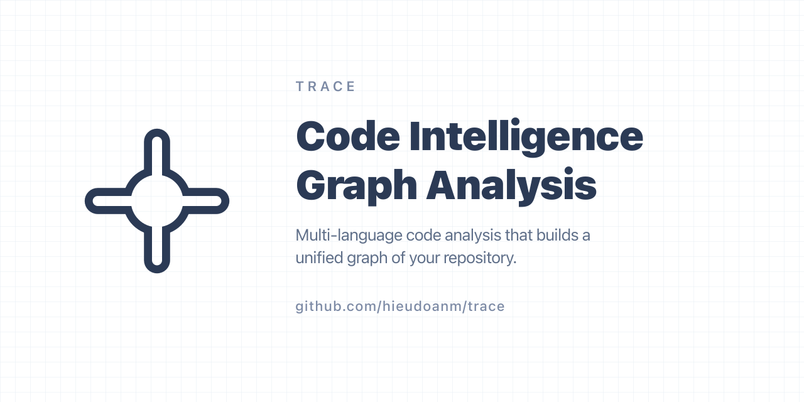

# Tracers



Tracers is a high-performance, multi-language code intelligence and graph analysis tool. It analyses source code repositories and builds a unified graph of their internal structure and relationships, enabling developers to understand codebase organization, follow function call chains, inspect dependencies, explore symbol references, and determine the impact of code changes.

## Features

- **Multi-language support**: TypeScript, Python, Go, Rust, Kotlin, Swift, Java, C#, PHP, Ruby, C, C++, Dart, Scala, and R
- **Framework detection**: Detects React, Vue, Angular, Express, Next.js, NestJS, Svelte, SvelteKit, Nuxt, Hono, tRPC, Prisma, and Drizzle ORM
- **Interactive Visual Explorer**: Built-in Obsidian-style graph view powered by D3.js & HTML5 Canvas with real-time physics, ego-network hover, search, and filtering
- **Syntax-level analysis**: Tree-sitter based parsing across all supported languages
- **Graph queries**: Find callers, callees, references, dependencies, and impact
- **Cycle detection**: Identify dependency cycles in your codebase
- **Path analysis**: Find paths between symbols and understand relationships
- **Incremental caching**: Fast repeated scans with content-addressed caching
- **Deterministic output**: Reproducible results for identical source trees
- **Machine-readable export**: JSON output with schema validation
- **Graph validation**: `tracers validate` checks every edge references an existing node
- **Local analysis**: No cloud services or external APIs required

## Installation

### From a release binary

Prebuilt binaries for Linux and macOS (x86_64 and aarch64) are attached to
GitHub releases:

```bash
curl -fsSL https://raw.githubusercontent.com/hieudoanm/tracers/main/scripts/install.sh | sh
```

The script detects your platform, downloads `tracers-<os>-<arch>`, and installs
it to `~/.local/bin`. To install from your local working tree instead:

```bash
./scripts/install-local.sh
```

### From source

```bash
# Clone the repository
git clone https://github.com/hieudoanm/tracers.git tracers
cd tracers

# Build with Cargo
cargo build --release

# The binary will be at target/release/tracers
```

### Requirements

- Rust 1.85 or later
- Cargo (comes with Rust)

## Quick Start

### Scan a repository

```bash
# Scan the current directory
tracers scan

# Scan and generate the interactive visual explorer (.tracers/graph.html)
tracers scan . --write-tracers-dir

# Scan a specific path
tracers scan /path/to/repository

# Write output to a file
tracers scan . -o graph.json

# Filter by language
tracers scan . --language typescript

# Exclude files matching a pattern
tracers scan . --exclude "node_modules/**"
```

### Query a graph

```bash
# Get statistics
tracers stats

# Find callers of a function
tracers callers myFunction

# Find callees of a function
tracers callees myFunction

# List references to a symbol
tracers refs MyClass

# Show dependencies
tracers deps src/main.ts

# Show transitive dependencies
tracers deps src/main.ts --transitive

# Impact analysis
tracers impact src/utils.ts

# Find a path between two symbols
tracers path mainFunction helperFunction

# Detect dependency cycles
tracers cycles

# Check configuration and parser availability
tracers check

# Validate graph integrity (every edge references an existing node)
tracers validate

# List supported languages
tracers languages
```

## Interactive Visual Graph Explorer

Tracers includes a built-in, standalone visual graph explorer inspired by Obsidian's graph view. It runs locally in any web browser without needing a backend server or node build step.

```bash
# Generate the explorer files in .tracers/
tracers scan . --write-tracers-dir

# Open the explorer in your browser (e.g. on macOS)
open .tracers/graph.html
# Or serve with any static web server (VS Code Live Server, python3 -m http.server, etc.)
```

### Explorer Features

- **Hardware-Accelerated Canvas (D3-force)**: Smooth 60 FPS rendering using HTML5 Canvas (`devicePixelRatio`-scaled) that easily handles thousands of nodes and edges without DOM bottlenecks.
- **Obsidian Aesthetic**: Dark `#0e0e12` theme with soft glowing nodes colored by symbol kind (Classes, Functions, Files, Modules, Interfaces, etc.).
- **Ego-Network Isolation**: Hovering or clicking any node focuses on its closed neighborhood, dimming unrelated nodes and edges to 8% opacity.
- **Degree-Based Scaling**: Automatically scales node radii by connectivity so architectural hubs stand out.
- **Live Search**: Instant substring search across symbol names and repository-relative file paths.
- **Filter Drawer**: Toggle visibility of specific node kinds (Classes, Functions, Methods, etc.) and edge types (Calls, Imports, Contains, Uses Type, etc.) with real-time count badges.
- **Physics Tuning**: Live sliders for *Node Size*, *Link Distance*, *Repulsion Force*, and *Center Gravity*.
- **Interactive Inspector**: Inspect symbol kind, file path, inbound/outbound degree counts, and click connected neighbors to smoothly pan across the codebase.
- **Resilient Rendering**: Automatically filters out missing or unresolved edge endpoints, preventing dangling edge crashes.

## CLI Reference

### Global Options

- `-v, --verbose`: Enable verbose logging
- `-q, --quiet`: Silence all non-error output
- `-h, --help`: Print help
- `-V, --version`: Print version

### Commands

#### `tracers scan [PATH]`

Analyse a repository and generate a graph.

**Options:**

- `-o, --output <PATH>`: Write output files (.json, .dot, .html) to PATH (file or directory) instead of stdout
- `--include <GLOB>`: Include only files matching this glob pattern (repeatable)
- `--exclude <GLOB>`: Exclude files matching this glob pattern (repeatable)
- `--language <LANGUAGE>`: Only analyse the given language(s)
- `--no-cache`: Disable the syntax cache
- `--jobs <N>`: Number of parallel jobs
- `--write-tracers-dir`: Write .tracers/ directory with graph.json, graph.dot, and graph.html (enabled by default)
- `--no-tracers-dir`: Disable writing the .tracers directory
- `--config <PATH>`: Path to a tracers.toml configuration file

#### `tracers graph [PATH]`

Load or construct a graph and provide filtered graph output.

**Options:**

- `--format <FORMAT>`: Output format: json or dot (default: `output.format` from tracers.toml, then json)
- `-o, --output <PATH>`: Write output to PATH instead of stdout
- `--language <LANGUAGE>`: Filter by language
- `--kind <KIND>`: Filter by node kind
- `--graph <PATH>`: Load the graph from an exported JSON file instead of rescanning, then apply filters and re-emit

#### `tracers callers <SYMBOL> [PATH]`

Display callers of a symbol.

**Options:**

- `--max-depth <N>`: Maximum traversal depth (default: 32)
- `--max-results <N>`: Maximum number of results (default: 1000)
- `--graph <PATH>`: Load the graph from an exported JSON file (e.g. `.tracers/graph.json`) instead of rescanning

#### `tracers callees <SYMBOL> [PATH]`

Display callees of a symbol.

**Options:**

- `--max-depth <N>`: Maximum traversal depth (default: 32)
- `--max-results <N>`: Maximum number of results (default: 1000)
- `--graph <PATH>`: Load the graph from an exported JSON file (e.g. `.tracers/graph.json`) instead of rescanning

#### `tracers refs <SYMBOL> [PATH]`

List references to a symbol.

**Options:**

- `--max-depth <N>`: Maximum traversal depth (default: 32)
- `--max-results <N>`: Maximum number of results (default: 1000)
- `--graph <PATH>`: Load the graph from an exported JSON file (e.g. `.tracers/graph.json`) instead of rescanning

#### `tracers deps <TARGET> [PATH]`

Display direct or transitive dependencies of a target.

**Options:**

- `--transitive`: Follow transitive dependencies
- `--max-depth <N>`: Maximum traversal depth (default: 32)
- `--max-results <N>`: Maximum number of results (default: 1000)
- `--graph <PATH>`: Load the graph from an exported JSON file (e.g. `.tracers/graph.json`) instead of rescanning

#### `tracers dependents <TARGET> [PATH]`

Display symbols and files that depend on a target (reverse dependency traversal over imports, `depends_on`, `uses_type`, `inherits` and `implements` edges).

**Options:**

- `--max-depth <N>`: Maximum traversal depth (default: 32)
- `--max-results <N>`: Maximum number of results (default: 1000)
- `--graph <PATH>`: Load the graph from an exported JSON file (e.g. `.tracers/graph.json`) instead of rescanning

#### `tracers reach <SYMBOL> [PATH]`

List nodes reachable from a symbol through calls, references, imports and other dependency edges.

**Options:**

- `--max-depth <N>`: Maximum traversal depth (default: 32)
- `--max-results <N>`: Maximum number of results (default: 1000)
- `--graph <PATH>`: Load the graph from an exported JSON file (e.g. `.tracers/graph.json`) instead of rescanning

#### `tracers impact <TARGET> [PATH]`

Display static impact analysis for a target.

**Options:**

- `--max-depth <N>`: Maximum traversal depth (default: 32)
- `--max-results <N>`: Maximum number of results (default: 1000)
- `--graph <PATH>`: Load the graph from an exported JSON file (e.g. `.tracers/graph.json`) instead of rescanning

#### `tracers path <SOURCE> <TARGET> [PATH]`

Find a path between two symbols or nodes.

**Options:**

- `--max-depth <N>`: Maximum traversal depth (default: 32)
- `--graph <PATH>`: Load the graph from an exported JSON file (e.g. `.tracers/graph.json`) instead of rescanning

#### `tracers roots [PATH]`

List callable symbols with no incoming `calls` edges (entry-point candidates). This is not a dead-code report: dynamic dispatch, reflection, exported entry points, tests and callbacks can all legitimately have no statically visible caller.

**Options:**

- `--max-results <N>`: Maximum number of results (default: 1000)
- `--graph <PATH>`: Load the graph from an exported JSON file (e.g. `.tracers/graph.json`) instead of rescanning

#### `tracers cycles [PATH]`

Detect dependency cycles.

**Options:**

- `--graph <PATH>`: Load the graph from an exported JSON file (e.g. `.tracers/graph.json`) instead of rescanning

#### `tracers stats [PATH]`

Report graph statistics, including resolution-status and framework breakdowns.

**Options:**

- `--graph <PATH>`: Load the graph from an exported JSON file (e.g. `.tracers/graph.json`) instead of rescanning

#### `tracers diagnostics [PATH]`

List analysis diagnostics collected during the scan: parse errors, unresolved imports, ambiguous symbols, skipped files and similar findings, sorted by severity.

**Options:**

- `--max-results <N>`: Maximum number of results (default: 1000)
- `--graph <PATH>`: Load the graph from an exported JSON file (e.g. `.tracers/graph.json`) instead of rescanning

#### `tracers languages`

Report supported languages and analysis capabilities.

#### `tracers frameworks [PATH]`

Report frameworks detected from manifests and source conventions.

**Options:**

- `--include <GLOB>` / `--exclude <GLOB>`: Filter discovered files (repeatable)
- `--language <LANGUAGE>`: Only analyse the given language(s)

#### `tracers check [PATH]`

Validate configuration, discovery, and parser availability. Reports file
counts (including gitignored and unsupported files), skip-reason breakdown,
cache status, detected languages, and configured external tools.

**Options:**

- `--include <GLOB>` / `--exclude <GLOB>`: Filter discovered files (repeatable)
- `--language <LANGUAGE>`: Only analyse the given language(s)

#### `tracers validate [PATH]`

Validate graph integrity: every edge must reference an existing node. Fails if any dangling edge targets are found.

**Options:**

- `--graph <PATH>`: Load the graph from an exported JSON file (e.g. `.tracers/graph.json`) instead of rescanning

## Architecture


Tracers is organized as a Rust workspace with the following crates:

- **tracers-core**: Core graph model, stable identities, graph validation, and query engine
- **tracers-parser**: Repository discovery and Tree-sitter syntax extraction across all 10 supported languages
- **tracers-analysis**: Symbol resolution (`resolve/`), graph construction (`graph/`), and incremental caching
- **tracers-export**: Deterministic JSON and DOT export with schema validation
- **tracers-cli**: Command-line interface (`cli/`) and embedded Obsidian-style D3 graph template

The core engine is independent of the visualization layer and does not execute or upload source code.

## Language Support

Tracers supports the following languages with syntax-level analysis:

| Language   | Extensions | Syntax | Symbols | Imports | Calls | Cross-file | Semantic |
| ---------- | ---------- | ------ | ------- | ------- | ----- | ---------- | -------- |
| TypeScript | .ts, .tsx  | ✅      | ✅       | ✅       | ✅     | ✅          | Planned  |
| Python     | .py        | ✅      | ✅       | ✅       | ✅     | ✅          | Planned  |
| Go         | .go        | ✅      | ✅       | ✅       | ✅     | ✅          | Planned  |
| Rust       | .rs        | ✅      | ✅       | ✅       | ✅     | ✅          | Planned  |
| Kotlin     | .kt, .kts  | ✅      | ✅       | ✅       | ✅     | ✅          | Planned  |
| Swift      | .swift     | ✅      | ✅       | ✅       | ✅     | ✅          | Planned  |
| Java       | .java      | ✅      | ✅       | ✅       | ✅     | ✅          | Planned  |
| C#         | .cs        | ✅      | ✅       | ✅       | ✅     | ✅          | Planned  |
| PHP        | .php       | ✅      | ✅       | ✅       | ✅     | ✅          | Planned  |
| Ruby       | .rb        | ✅      | ✅       | ✅       | ✅     | ✅          | Planned  |

### Current Limitations

- **TypeScript**: Relative ES module imports are resolved. tsconfig path aliases are not applied. Method resolution uses lexical scope and simple local type inference.
- **Python**: Absolute and relative module imports are resolved against discovered files. Dynamic imports, monkey-patching, and decorator effects are not modelled.
- **Go**: Imports resolve through go.mod module paths and package directories. Interface method sets are reported syntactically; satisfaction is not type-checked.
- **Rust**: crate/self/super use paths and simple module files are resolved. Macro expansion and trait method resolution are not performed.
- **Kotlin**: Imports and same-package declarations are resolved. Overload selection and extension resolution are conservative.
- **Swift**: Files in the same Swift package/module root share a lexical scope. Protocol witness and dynamic dispatch resolution are not performed.
- **Java**: Imports and same-package declarations are resolved. Overloads and type erasure are handled conservatively.
- **C#**: Using directives and namespace scope are considered. Advanced generics and LINQ are not fully modelled.
- **PHP**: Use statements and namespaced declarations are resolved. Dynamic includes and magic methods are not modelled.
- **Ruby**: require/require_relative are tracked. Dynamic method definition and metaprogramming are not modelled.

## Configuration

Tracers supports an optional project-level configuration file `tracers.toml`.

### Example Configuration

```toml
[analysis]
# Maximum file size in bytes (default: 1048576)
max_file_size = 1048576

# Follow symbolic links (default: false)
follow_symlinks = false

# Include generated code (default: false)
include_generated = false

# Enabled languages (default: all)
languages = ["typescript", "python", "go", "rust", "kotlin", "swift"]

# Glob patterns limiting which files are discovered (default: none)
include = []
exclude = []

# Parallel parse jobs (default: number of CPUs; 1 forces sequential)
jobs = 4

# Semantic analysis mode (default: "off"; "auto" falls back to syntax analysis)
semantic = "off"

[cache]
# Enable caching (default: true)
enabled = true

# Cache directory (default: ".tracers-cache")
directory = ".tracers-cache"

# Evict cache entries older than this many days (default: 30; 0 disables pruning)
max_age_days = 30

[output]
# Default output format (default: "json")
format = "json"
```

### Configuration Priority

Command-line arguments override configuration file values, which override defaults.

## Graph Schema

Tracers outputs a versioned JSON graph schema containing:

- **Repository metadata**: ID, name, root path, file count, language count
- **Analysis metadata**: Format, cache status, semantic mode, enabled languages
- **Language information**: Supported languages and grammar versions
- **Nodes**: Source code entities (files, modules, classes, functions, etc.)
- **Edges**: Relationships between entities (contains, imports, calls, references, etc.)
- **Diagnostics**: Parse errors, unresolved imports, ambiguous symbols
- **Statistics**: Counts by node kind, edge kind, language, and resolution status

### Node Kinds

- `repository`, `file`, `module`, `package`, `namespace`
- `class`, `struct`, `interface`, `trait`, `enum`
- `function`, `method`, `constructor`
- `variable`, `constant`, `type`, `property`, `parameter`
- `external_symbol`, `unknown`

### Edge Kinds

- `contains`, `imports`, `exports`
- `calls`, `references`
- `inherits`, `implements`, `uses_type`
- `defines`, `overrides`, `depends_on`

### Resolution Status

- `resolved_internal`: Resolved to a symbol within the repository
- `resolved_external`: Resolved to an external dependency
- `unresolved`: Could not be resolved
- `ambiguous`: Multiple possible targets

### Identity Notes

- Unresolved references materialise as `unresolved:<language>:<name>`
  placeholder nodes so the graph stays target-complete; the language
  qualifier keeps same-named unresolved symbols in different languages
  distinct.
- External dependencies materialise as `external:<language>:<qualified>`
  nodes when `include_external` is enabled.
- Multiple call sites between the same pair of symbols are aggregated into
  a single edge whose `sites` array records every source location.

## Development

### Building

```bash
# Build the workspace
cargo build --workspace

# Build with optimizations
cargo build --release

# Run tests
cargo test --workspace

# Run formatting checks
cargo fmt --check

# Run linter
cargo clippy --workspace --all-targets --all-features -- -D warnings
```

### Testing

```bash
# Run all tests
cargo test --workspace

# Run tests for a specific crate
cargo test -p tracers-core
cargo test -p tracers-parser
cargo test -p tracers-analysis
cargo test -p tracers-export
cargo test -p tracers-cli
```

### Running the CLI

```bash
# Build and run
cargo run -- scan /path/to/repo

# Or use the built binary
./target/debug/tracers scan /path/to/repo
```

## Contributing

Contributions are welcome! Please see [CONTRIBUTING.md](CONTRIBUTING.md) for guidelines.

## License

MIT License - see [LICENSE](LICENSE) for details.

## Acknowledgments

Tracers uses:

- [tree-sitter](https://tree-sitter.github.io/) for incremental syntax parsing
- [petgraph](https://github.com/petgraph/petgraph) for graph algorithms
- [serde](https://serde.rs/) for serialization
